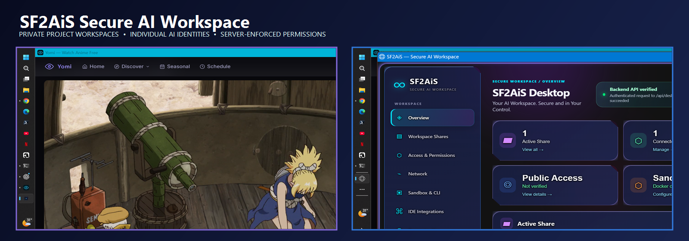
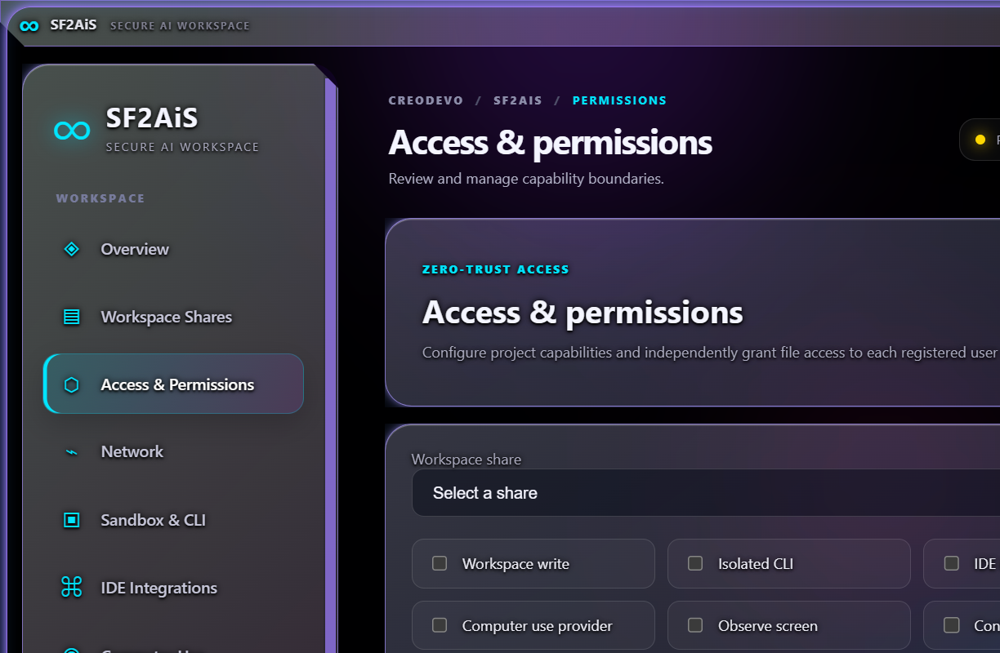
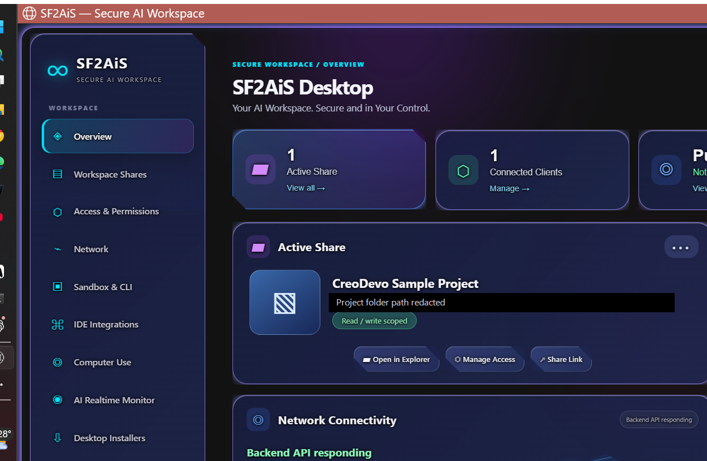

<p align="center">
  
</p>

<h1 align="center">SF2AiS Secure AI Workspace</h1>
<p align="center">A self-hosted, permission-scoped workspace for people and AI clients.</p>
<p align="center">
  
  
</p>

SF2AiS provides an authenticated gateway to selected project folders on your own server. People and AI clients receive individual identities, and the server enforces their permissions on every supported file operation. The desktop client and browser interface use the same renderer and design system.

## Current capabilities

- **Project-folder sharing:** register a folder as a workspace boundary. New desktop-created projects do not use a shared folder username/password.
- **Per-identity access:** issue a unique, revocable token for each connected AI or user identity.
- **Granular file permissions:** independently control Read, Write, Upload, Download and Deny for the project root and individual files or subfolders.
- **Path overrides:** browse the server-side project tree and add permissions for a selected file or folder. More-specific rules inherit unspecified rights; an explicit Deny always wins.
- **Server-side enforcement:** workspace and IDE file APIs, browser workspace operations, uploads and downloads check the authenticated identity's effective permissions.
- **Capability controls:** CLI, IDE, Git, tunnels and computer-use permissions are separate from file access.
- **Audit trail:** record identity, share, operation and path metadata without recording tokens or file contents.
- **Network administration:** configure DDNS, inspect router discovery and request explicitly approved temporary mappings. Public access is not enabled merely by starting the server.
- **Desktop client:** Electron app with a system-tray probe, server administration, AI client registration, project permissions, network settings, activity and glassmorphism appearance controls.

## Security model

### Project folder and identity flow

1. The administrator registers a project folder.
2. The administrator registers an AI/user identity and receives its unique token once.
3. The new identity starts with **no project-file access**.
4. The administrator selects that identity from the Connected user / AI dropdown.
5. Grant the required root permissions, then add narrower file/folder overrides where needed.
6. The AI presents its token in the X-Sf2AiS-Token request header. The server resolves the identity and checks the requested path and action before touching the file.

| Permission | Controls |
|---|---|
| Read | Browse folders and read file contents |
| Write | Create, edit, move and delete project files |
| Upload | Send a file into an allowed project path |
| Download | Download a file from an allowed project path |
| Deny | Block access at this path and all descendants, overriding inherited grants |

The project-level **Workspace write** switch is an additional administrator-controlled master gate for writes and uploads. It must be enabled before identity-level Write or Upload grants can take effect.

### Important boundaries

- Existing legacy shares may still use their old HTTP Basic credentials. New shares created through the desktop app are token-only; Basic authentication is disabled for those shares.
- The desktop administrator login is separate from AI client tokens. The Electron client stores its administrator credential using the operating system's secure credential storage.
- CLI can read/write the mounted project as a whole. To prevent it bypassing path-level restrictions, CLI is available to a client only when the client has unrestricted root Read, Write, Upload and Download permissions and no path overrides.
- Git operations are repository-wide. They are disabled for clients with path-specific overrides.
- A legacy admin-managed connection/session API exists, but it is separate from the per-project client-token system. Creating and approving those requests requires administrator authentication. Windows Hello/passkeys, biometric approval, authenticator-app TOTP, recovery codes and trusted-device auto-accept are not integrated into either client-token issuance or that approval API.

## Start the server

### Windows (recommended)

From the repository root:

```powershell
pwsh -ExecutionPolicy Bypass -File Scripts\Startup.ps1
```

The helper starts the FastAPI server on loopback port 8000, opens the browser workspace, and registers the optional desktop-probe scheduled task. Use -NoProbe to skip the scheduled task or -Port 8010 to choose another local port.

### Manual start

```powershell
python -m pip install -r requirements.txt
python -m uvicorn main:app --host 127.0.0.1 --port 8000
```

Open http://127.0.0.1:8000/workspace and sign in with the administrator account created during setup. Keep the backend on loopback when placing a TLS reverse proxy such as Caddy in front of it.

### Linux / macOS

```bash
python3 -m pip install -r requirements.txt
python3 -m uvicorn main:app --host 127.0.0.1 --port 8000
```

See the Startup Guide for service setup, reverse-proxy notes and shutdown procedures.

## Desktop client

Source: probe-app/

```powershell
cd probe-app
npm install
npm run build:dir
```

For a Windows x64 distributable, use the build scripts documented in probe-app/package.json. The unpacked test build is written to probe-app/dist/win-unpacked/. Do not commit generated build folders or old installers.

The desktop client can connect to the server using the administrator account, create project folders, register AI identities, configure server capabilities, manage per-identity permissions and inspect activity. The web interface shares the renderer but omits local-only Windows probe controls.

## Operations

1. Open **Workspace Shares** and add the project folder on the server.
2. Open **Access & Permissions**, select the project and enable the share-level Workspace write master switch only if writes/uploads are required.
3. Register one AI/user identity per distinct client or agent.
4. Select that identity in **Connected identity permissions**.
5. Set root permissions and use **Choose file / folder** to add narrower path overrides.
6. Save the policy. The server applies it immediately to subsequent requests.
7. Revoke a client token when the connection is no longer trusted.

See the Operations Guide for detailed procedures, backup, recovery, audit review and troubleshooting.

## Tests

```powershell
python -m py_compile main.py project_access.py
python -m pytest tests -q
node --check probe-app\renderer\app.js
cd probe-app
npm run build:dir
```

The permission-specific regression tests are in tests/test_project_access.py.

## Documentation

- Startup Guide: Docs/STARTUP_GUIDE.md
- Operations Guide: Docs/OPERATIONS_GUIDE.md
- Security: Docs/SECURITY.md
- Security Architecture: Docs/Security Architecture.md
- Architecture: Docs/Architecture.md
- Connection Guide: Docs/CONNECTION_GUIDE.md
- HTTP API Reference: Docs/HTTP API Reference.md
- Test Plan: Docs/Test Plan.md
- Desktop Operating Guide: probe-app/OPERATING_GUIDE.md

## Repository screenshots

The desktop and server screenshots above are documentation captures of the current interface. GitHub's repository social-preview image is a separate repository setting; the banner is also included at the top of this README so it appears on the repository landing page itself.

## License

See Docs/LICENSE.md.
